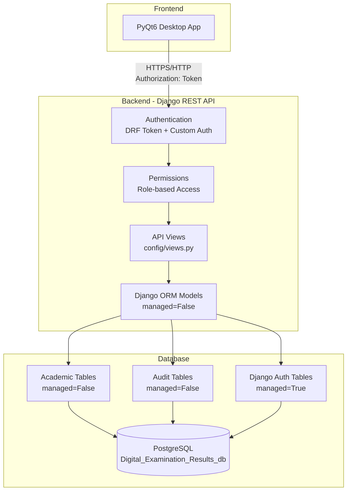

# Backend — Django REST API

This document provides comprehensive technical documentation for the backend of the Digital Examination Results Management System. It is intended for backend developers who need to understand, configure, maintain, and extend the Django REST API.

## A. Backend Overview

**Purpose:** The backend serves as a Django REST Framework API that provides authenticated access to an existing PostgreSQL database containing academic records (students, programmes, modules, examinations, questions, and results). It handles authentication, authorization, data validation, and business logic for the PyQt6 desktop frontend.

**Framework and architecture:** Django 5.2 with Django REST Framework 3.16. The project follows a modular app structure with separate apps for accounts, academics, students, examinations, and results. All academic models use `managed=False` to map existing PostgreSQL tables without Django managing their schema.

**Responsibilities:**
- Authentication and authorization via DRF tokens (12-hour expiry)
- Role-based access control (institution_admin, staff)
- CRUD operations for academic entities
- Grade calculation based on examination maximum_score
- Duplicate result prevention
- Audit logging for result changes
- Reporting and dashboard aggregates

**Communication with frontend:** RESTful JSON API over HTTP. The frontend sends `Authorization: Token <token>` header for authenticated requests. All API endpoints are under `/api/`.

**Database integration:** Connects to an existing PostgreSQL database. Academic tables are unmanaged (`managed=False`); only Django auth, contenttypes, sessions, and DRF authtoken tables are managed. The database name is `Digital_Examination_Results_db`.

## B. Backend Architecture

### Django Project Configuration

The Django project is in `backend/config/`:
- `settings.py` — Main configuration (loads from `.env`)
- `production_settings.py` — Hardened production settings
- `test_settings.py` — In-memory SQLite for isolated tests
- `urls.py` — Root URL routing
- `views.py` — All API view functions (function-based views)

### Django Applications

| App | Purpose | Key Models |
|---|---|---|
| `accounts` | Institution, user profiles, authentication | `Institution`, `UserProfile` |
| `academics` | Academic years, programmes, modules | `AcademicYear`, `Programme`, `Module`, `ProgrammeModule` |
| `students` | Student records | `Student` |
| `examinations` | Examinations and questions | `Examination`, `Question` |
| `results` | Examination results and audit | `ExamResult`, `ResultAudit` |

### Models

All academic models (`AcademicYear`, `Programme`, `Module`, `ProgrammeModule`, `Student`, `Examination`, `Question`, `ExamResult`, `ResultAudit`) have `managed=False` in their `Meta` class, mapping to existing PostgreSQL tables.

### Views

All API endpoints are implemented as function-based views in `config/views.py` using DRF decorators (`@api_view`, `@permission_classes`). Views handle serialization manually (no DRF serializers for academic data, only for accounts).

### Serializers

Only the `accounts` app uses DRF serializers:
- `InitialAdministratorSerializer` — First admin registration
- `AdministratorInputSerializer` — Provisioning additional admins
- `AdministratorStatusSerializer` — Activate/deactivate admin
- `InstitutionNameSerializer` — Update institution name
- `StudentSerializer` — Student create/update

### URL Routing

Defined in `config/urls.py`. All endpoints under `/api/` prefix.

### Middleware

Minimal middleware stack:
- `SecurityMiddleware`
- `CommonMiddleware`
- `SessionMiddleware`
- `AuthenticationMiddleware`

### Permissions

Custom permissions in `apps.accounts.permissions`:
- `IsInstitutionAdministrator` — Full access
- `IsInstitutionAdministratorOrReadOnly` — Read for all, write for admin
- `IsInstitutionStaffOrAdministrator` — Staff and admin access
- `IsInstitutionUser` — Any authenticated institution user

### Authentication

Custom `InstitutionTokenAuthentication` extends DRF's `TokenAuthentication`. Validates that the token's user has an active `UserProfile` with an institution.

### Database Access

Direct Django ORM usage with `managed=False` models. Raw SQL only for health check (`SELECT 1`) and audit table defaults (`CURRENT_USER`).

### Business Logic

Key functions in `config/views.py`:
- `calculate_grade(score, maximum_score)` — Percentage-based grading
- `serialize_*` functions — Manual JSON serialization
- `_report_data()`, `_student_report_data()`, `_recent_dashboard_results()` — Aggregations

### Mermaid Backend Architecture Diagram



## C. Backend Directory Structure

```
backend/
├── .env                          # Local configuration (not committed)
├── .env.example                  # Template with placeholders
├── manage.py                     # Django management script
├── README.md                     # This file
├── requirements.txt              # Python dependencies
├── API_DOCUMENTATION.md          # API endpoint reference
├── views_tmp.txt                 # Temporary file (ignore)
├── apps/
│   ├── __init__.py
│   ├── accounts/                 # Authentication and user management
│   │   ├── __init__.py
│   │   ├── apps.py
│   │   ├── models.py             # Institution, UserProfile
│   │   ├── views.py              # Auth endpoints
│   │   ├── serializers.py        # DRF serializers for accounts
│   │   ├── permissions.py        # Custom permission classes
│   │   ├── authentication.py     # Custom token authentication
│   │   ├── throttles.py          # Rate limiting
│   │   ├── password_validators.py # Custom password complexity
│   │   ├── management/
│   │   │   └── commands/
│   │   │       └── reset_institution_admin_password.py
│   │   └── migrations/
│   │       └── 0001_initial.py   # Creates accounts_institution, accounts_userprofile
│   ├── academics/                # Academic years, programmes, modules
│   │   ├── __init__.py
│   │   ├── apps.py
│   │   └── models.py             # AcademicYear, Programme, Module, ProgrammeModule
│   ├── core/                     # Shared utilities
│   │   ├── __init__.py
│   │   ├── apps.py
│   │   ├── fields.py             # UTCNaiveDateTimeField
│   │   ├── tests.py
│   │   └── management/
│   │       └── commands/
│   │           ├── create_account.py
│   │           ├── create_admin.py
│   │           └── initialize_db.py
│   ├── students/                 # Student records
│   │   ├── __init__.py
│   │   ├── apps.py
│   │   ├── models.py             # Student
│   │   └── serializers.py        # StudentSerializer
│   ├── examinations/             # Examinations and questions
│   │   ├── __init__.py
│   │   ├── apps.py
│   │   └── models.py             # Examination, Question
│   └── results/                  # Examination results and audit
│       ├── __init__.py
│       ├── apps.py
│       └── models.py             # ExamResult, ResultAudit
├── config/
│   ├── __init__.py
│   ├── settings.py               # Main Django settings
│   ├── production_settings.py    # Production-hardened settings
│   ├── test_settings.py          # Test settings (SQLite)
│   ├── urls.py                   # Root URL configuration
│   ├── views.py                  # All API view functions
│   ├── asgi.py
│   └── wsgi.py
└── tests/
    ├── __init__.py
    ├── test_accounts.py
    ├── test_auth_verify.py
    └── test_academic_helpers.py
```

### Important Files

| File | Responsibility |
|---|---|
| `config/settings.py` | Loads env, configures DB, REST_FRAMEWORK, auth validators, apps |
| `config/production_settings.py` | Security headers, SSL, HSTS, logging, connection pooling |
| `config/urls.py` | Maps all `/api/` endpoints to view functions |
| `config/views.py` | All API logic: serialization, permissions, business logic, grade calculation |
| `apps.accounts.authentication` | `InstitutionTokenAuthentication` — validates token + active profile |
| `apps.accounts.permissions` | Role-based permission classes |
| `apps.accounts.throttles` | `LoginRateThrottle` (20/hr), `RegistrationRateThrottle` (5/hr) |
| `apps.core.fields.UTCNaiveDateTimeField` | Timezone-naive UTC datetime for DB compatibility |

## D. Installation and Configuration

### Prerequisites

- Python 3.10+
- PostgreSQL server with existing `Digital_Examination_Results_db` database
- Database user with appropriate permissions

### Virtual Environment and Dependencies

```powershell
cd backend
py -m venv .venv
.\.venv\Scripts\Activate.ps1
python -m pip install --upgrade pip
python -m pip install -r requirements.txt
```

### Environment Configuration

Copy `.env.example` to `.env` and set values:

```powershell
Copy-Item .env.example .env
# Edit .env with your values
```

Required variables:
- `DJANGO_SECRET_KEY` — Long random string (generate with Django's `get_random_secret_key()`)
- `DJANGO_DEBUG` — `True` or `False` (default `False`)
- `DJANGO_ALLOWED_HOSTS` — Comma-separated hosts (default `127.0.0.1,localhost`)
- `PGHOST` — PostgreSQL host (default `127.0.0.1`)
- `PGPORT` — PostgreSQL port (default `5432`)
- `PGDATABASE` — Database name (must be `Digital_Examination_Results_db`)
- `PGUSER` — PostgreSQL username
- `PGPASSWORD` — PostgreSQL password

### PostgreSQL Configuration

The database must already exist with the academic schema. Do not create tables via Django migrations for academic models.

Required tables (managed externally):
- `academic_years`
- `programmes`
- `modules`
- `programme_modules`
- `students`
- `examinations`
- `questions`
- `exam_results`
- `result_audit`

Django-managed tables (created by migrations):
- `django_migrations`
- `django_content_type`
- `auth_permission`
- `auth_group`
- `auth_group_permissions`
- `auth_user`
- `auth_user_groups`
- `auth_user_user_permissions`
- `django_session`
- `authtoken_token`
- `accounts_institution`
- `accounts_userprofile`

### Django Startup

```powershell
# Check configuration
python manage.py check

# Inspect migrations (review with DBA before applying)
python manage.py showmigrations
python manage.py migrate --plan

# Apply reviewed migrations
python manage.py migrate

# Start development server
python manage.py runserver 127.0.0.1:8000
```

For production, use `production_settings`:

```powershell
python manage.py runserver --settings=config.production_settings 0.0.0.0:8000
```

## E. Environment Variables

| Variable | Required | Default | Description |
|---|---|---|---|
| `DJANGO_SECRET_KEY` | Yes | — | Django secret key for signing |
| `DJANGO_DEBUG` | No | `False` | Enable debug mode |
| `DJANGO_ALLOWED_HOSTS` | No | `127.0.0.1,localhost` | Comma-separated allowed hosts |
| `PGHOST` | No | `127.0.0.1` | PostgreSQL host |
| `PGPORT` | No | `5432` | PostgreSQL port |
| `PGDATABASE` | Yes | — | Database name (`Digital_Examination_Results_db`) |
| `PGUSER` | Yes | — | PostgreSQL username |
| `PGPASSWORD` | Yes | — | PostgreSQL password |

Example `.env`:
```ini
DJANGO_SECRET_KEY=your-generated-secret-key-here
DJANGO_DEBUG=False
DJANGO_ALLOWED_HOSTS=127.0.0.1,localhost,api.example.com
PGHOST=127.0.0.1
PGPORT=5432
PGDATABASE=Digital_Examination_Results_db
PGUSER=exam_user
PGPASSWORD=secure-password-here
```

## F. Database Integration

### PostgreSQL Connection

Configured in `settings.py` `DATABASES['default']`:
- Engine: `django.db.backends.postgresql`
- Connection timeout: 5 seconds
- Application name: `digital_examination_results_backend`
- `CONN_MAX_AGE = 0` (development); `60` (production)

### Database Tables and Purposes

| Table | Purpose | Managed by Django |
|---|---|---|
| `academic_years` | Academic year periods | No |
| `programmes` | Academic programmes | No |
| `modules` | Course modules | No |
| `programme_modules` | Many-to-many programme-module links | No |
| `students` | Student records | No |
| `examinations` | Examination definitions | No |
| `questions` | Examination questions | No |
| `exam_results` | Student examination scores | No |
| `result_audit` | Audit log for result changes | No |
| `accounts_institution` | Institution record (singleton) | Yes |
| `accounts_userprofile` | User profile with role/institution | Yes |
| Django auth tables | Users, groups, permissions | Yes |
| `authtoken_token` | DRF authentication tokens | Yes |

### Important Relationships

- `Programme` ↔ `Module` — Many-to-many via `ProgrammeModule`
- `Examination` → `Module` (FK), `AcademicYear` (FK)
- `Question` → `Examination` (FK)
- `Student` → `Programme` (FK)
- `ExamResult` → `Student` (FK), `Examination` (FK)
- `UserProfile` → `User` (OneToOne), `Institution` (FK)

### Constraints

- `Programme.programme_code` — Unique
- `Programme.programme_name` — Unique
- `Module.module_code` — Not unique alone (unique per programme via `ProgrammeModule`)
- `Student.admission_number` — Unique
- `ExamResult` — Unique constraint on `(student, examination)` preventing duplicates
- `UserProfile.email` — Case-insensitive unique

### Indexes

Standard indexes on primary keys and foreign keys. No custom indexes defined in models.

### Views, Triggers, Stored Procedures

The PostgreSQL database contains:
- Triggers on `exam_results` for grade calculation and audit logging
- The `calculate_grade` logic is duplicated in Python (`config/views.py:38-51`) for API responses
- Audit triggers write to `result_audit` on UPDATE/DELETE

**Do not run Django migrations that alter academic tables.** They are `managed=False`.

### Django Model/Database Mapping

Each model maps 1:1 to its table. Field names use Django conventions (`snake_case`) with `db_column` specifying the actual PostgreSQL column where different.

### Migration Strategy

1. **Never** use `--fake-initial` for academic tables.
2. Only apply migrations for `accounts`, `auth`, `contenttypes`, `sessions`, `authtoken`.
3. Before any migration on production:
   - Backup database
   - Run `showmigrations` and `migrate --plan`
   - DBA reviews planned changes
   - Apply only approved migrations

## G. API Documentation

All endpoints are under `/api/`. Protected endpoints require `Authorization: Token <token>`.

### 1. Authentication

| Method | Endpoint | Access | Purpose |
|---|---|---|---|
| GET | `/auth/registration-status/` | Public | Check if initial registration is open |
| POST | `/auth/register/` | Public (once) | Register first institution administrator |
| POST | `/auth/login/` | Public | Obtain DRF token |
| POST | `/auth/logout/` | Authenticated | Revoke current token |
| GET | `/auth/me/` | Authenticated | Current account and institution |
| PATCH | `/auth/institution/` | Institution admin | Update institution name |
| GET | `/auth/admins/` | Institution admin | List administrators |
| POST | `/auth/admins/` | Institution admin | Provision additional administrator |
| PATCH | `/auth/admins/<user_id>/` | Institution admin | Activate/deactivate administrator |

**Registration request body:**
```json
{
  "institution_name": "University Name",
  "administrator_name": "John Doe",
  "username": "jdoe",
  "email": "jdoe@university.edu",
  "password": "SecurePass123!",
  "confirm_password": "SecurePass123!"
}
```

**Login request body:**
```json
{
  "username": "jdoe",
  "password": "SecurePass123!"
}
```

**Login response:**
```json
{
  "token": "abcdef123456...",
  "username": "jdoe",
  "role": "institution_admin",
  "administrator_name": "John Doe",
  "institution": "University Name"
}
```

Tokens expire after 12 hours.

### 2. Students

| Method | Endpoint | Access | Purpose |
|---|---|---|---|
| GET | `/students/` | Staff, Admin | List students (supports `search`, `programme` query params) |
| POST | `/students/` | Staff, Admin | Create student |
| GET | `/students/<student_id>/` | Staff, Admin | Retrieve student |
| PUT | `/students/<student_id>/` | Staff, Admin | Update student |
| DELETE | `/students/<student_id>/` | Admin only | Delete student (blocked if results exist) |

**Student request body:**
```json
{
  "admission_number": "ADM-001",
  "first_name": "Ada",
  "last_name": "Example",
  "age": 20,
  "gender": "Female",
  "programme_id": 1
}
```

**Student response:**
```json
{
  "student_id": 1,
  "admission_number": "ADM-001",
  "first_name": "Ada",
  "last_name": "Example",
  "age": 20,
  "gender": "Female",
  "programme_id": 1,
  "programme_code": "BSE",
  "date_registered": "2024-01-15T10:30:00",
  "is_active": true
}
```

### 3. Programmes

| Method | Endpoint | Access | Purpose |
|---|---|---|---|
| GET | `/programmes/` | Institution users | List programmes (supports `code` query) |
| POST | `/programmes/` | Admin | Create programme |
| GET | `/programmes/<programme_id>/` | Institution users | Retrieve programme |
| PUT | `/programmes/<programme_id>/` | Admin | Update programme |
| DELETE | `/programmes/<programme_id>/` | Admin | Delete programme (blocked if referenced) |

**Programme request body:**
```json
{
  "programme_code": "BSE",
  "programme_name": "BSc Software Engineering",
  "description": "Software engineering programme",
  "is_active": true
}
```

### 4. Modules

| Method | Endpoint | Access | Purpose |
|---|---|---|---|
| GET | `/modules/` | Institution users | List modules |
| POST | `/modules/` | Admin | Create module (optional `programme_id` to link) |
| GET | `/modules/<module_id>/` | Institution users | Retrieve module |
| PUT | `/modules/<module_id>/` | Admin | Update module (optional `programme_id` to re-link) |
| DELETE | `/modules/<module_id>/` | Admin | Delete module (blocked if referenced) |

**Module request body:**
```json
{
  "module_code": "OOP",
  "module_name": "Object-Oriented Programming",
  "level": "1",
  "semester": "2",
  "description": "OOP fundamentals",
  "is_active": true,
  "programme_id": 1
}
```

### 5. Academic Years

| Method | Endpoint | Access | Purpose |
|---|---|---|---|
| GET | `/academic-years/` | Institution users | List academic years |

### 6. Examinations

| Method | Endpoint | Access | Purpose |
|---|---|---|---|
| GET | `/examinations/` | Institution users | List examinations with questions |
| POST | `/examinations/` | Admin | Create examination |
| GET | `/examinations/<examination_id>/` | Institution users | Retrieve examination with questions |
| PUT | `/examinations/<examination_id>/` | Admin | Update examination |
| DELETE | `/examinations/<examination_id>/` | Admin | Delete examination (blocked if referenced) |

**Examination request body:**
```json
{
  "examination_code": "FINAL-BSE-101",
  "examination_title": "Final Examination",
  "module_id": 1,
  "academic_year_id": 1,
  "examination_type": "Final",
  "examination_date": "2024-06-15",
  "maximum_score": 100,
  "duration_minutes": 120,
  "status": "Scheduled"
}
```

**Note:** Administrators receive `correct_answer` in question objects; other roles do not.

### 7. Questions

| Method | Endpoint | Access | Purpose |
|---|---|---|---|
| GET | `/examinations/<examination_id>/questions/` | Institution users | List questions for examination |
| POST | `/examinations/<examination_id>/questions/` | Admin | Add question to examination |
| GET | `/questions/<question_id>/` | Institution users | Retrieve question |
| PUT | `/questions/<question_id>/` | Admin | Update question |
| DELETE | `/questions/<question_id>/` | Admin | Delete question |

**Question request body:**
```json
{
  "question_text": "What is OOP?",
  "question_type": "short_answer",
  "marks": 10,
  "question_order": 1,
  "options": null,
  "correct_answer": "Object-Oriented Programming"
}
```

Question types: `mcq`, `true_false`, `short_answer` (stored as `MCQ`, `TRUE_FALSE`, `SHORT_ANSWER`).

### 8. Results

| Method | Endpoint | Access | Purpose |
|---|---|---|---|
| GET | `/results/` | Staff, Admin | List results (supports `student`, `examination` query params) |
| POST | `/results/` | Staff, Admin | Create result |
| GET | `/results/<result_id>/` | Staff, Admin | Retrieve result |
| PUT | `/results/<result_id>/` | Staff, Admin | Update result (score, remarks) |
| DELETE | `/results/<result_id>/` | Admin only | Delete result |

**Create result request body:**
```json
{
  "student_id": 1,
  "examination_id": 1,
  "score": 85.5,
  "remarks": "Good performance"
}
```

**Validation:**
- Score must be finite, ≥ 0, ≤ examination's `maximum_score`
- Duplicate `(student_id, examination_id)` rejected (409)

**Result response:**
```json
{
  "result_id": 1,
  "student_id": 1,
  "examination_id": 1,
  "score": "85.50",
  "grade": "A",
  "remarks": "Good performance",
  "date_recorded": "2024-06-15T10:30:00",
  "last_updated": "2024-06-15T10:30:00"
}
```

Grade is calculated server-side: `percentage = score * 100 / maximum_score`. Boundaries: ≥70=A, ≥60=B, ≥50=C, ≥40=D, else F.

### 9. Reports

| Method | Endpoint | Access | Purpose |
|---|---|---|---|
| GET | `/reports/` | Institution users | Aggregate statistics + student performance table |

**Response:**
```json
{
  "total_students": 150,
  "total_programmes": 3,
  "total_modules": 25,
  "total_examinations": 40,
  "total_results": 1200,
  "passed": 950,
  "failed": 250,
  "grade_distribution": {"A": 300, "B": 350, "C": 200, "D": 100, "F": 250},
  "student_reports": [
    {
      "student_id": "ADM-001",
      "name": "Ada Example",
      "programme": "BSE",
      "total_score": 425.5,
      "average_score": 85.1,
      "overall_grade": "A"
    }
  ]
}
```

### 10. Dashboard

| Method | Endpoint | Access | Purpose |
|---|---|---|---|
| GET | `/dashboard/` | Institution users | Counts and recent student averages |

**Response:**
```json
{
  "counts": {
    "students": 150,
    "programmes": 3,
    "modules": 25,
    "examinations": 40,
    "results": 1200
  },
  "recent_results": [
    {
      "name": "Ada Example",
      "programme": "BSE",
      "average_score": 85.1,
      "overall_grade": "A"
    }
  ]
}
```

### 11. Health Check

| Method | Endpoint | Access | Purpose |
|---|---|---|---|
| GET | `/status/` | Public | Database connectivity check |

**Response:**
```json
{
  "status": "ok",
  "database": "postgresql",
  "authentication_configured": true,
  "data_api_available": true
}
```

## H. Authentication and Authorization

### Login Process

1. Client sends `POST /api/auth/login/` with `username` and `password`.
2. Backend authenticates via Django's `authenticate()`.
3. Validates user is active and has `UserProfile` with institution.
4. Creates or retrieves DRF `Token` (expires after 12 hours).
5. Returns token, username, role, administrator name, institution.

### Logout Process

1. Client sends `POST /api/auth/logout/` with `Authorization: Token <token>`.
2. Backend deletes the user's token.
3. Client clears local token.

### User Authentication Mechanism

- DRF `TokenAuthentication` extended by `InstitutionTokenAuthentication`.
- Token validated; user must have active `UserProfile` linked to institution.
- Token expiry: 12 hours (enforced in login view).

### Password Handling

- Django's `create_user()` hashes passwords with PBKDF2.
- Password validators enforced:
  - Minimum 12 characters
  - At least one letter, one number, one special character
  - Not similar to username/email
  - Not a common password
  - Not entirely numeric
  - Custom `PasswordComplexityValidator`

### Role-Based Permissions

| Role | Description | Permissions |
|---|---|---|
| `institution_admin` | Full administrative access | All CRUD, admin management, delete students/results |
| `staff` | Academic staff | Read all, create/update students/results, no delete, no programme/module/exam mutations |

### Administrator Privileges

- Provision additional administrators (`POST /auth/admins/`)
- Activate/deactivate administrators (`PATCH /auth/admins/<user_id>/`)
- Delete students (only if no results exist)
- Delete results
- Mutate programmes, modules, examinations, questions
- Update institution name
- Cannot deactivate own account or last active admin

### Staff Privileges

- Create/update students
- Create/update results
- Read all academic data
- Cannot delete students or results
- Cannot mutate programmes, modules, examinations, questions

### Student Access Restrictions

- No direct student login in current implementation
- Students are data subjects, not API users
- All access mediated through institution admin/staff accounts

## I. Business Logic

### Student Registration

1. Staff/admin submits `POST /api/students/` with admission number, names, age, gender, programme_id.
2. Backend validates via `StudentSerializer`.
3. Creates `Student` record.
4. Admission number must be unique.
5. Programme must exist.

### Examination Creation

1. Admin submits `POST /api/examinations/` with code, title, module_id, academic_year_id, type, date, maximum_score, duration, status.
2. Validates module and academic year exist.
3. Creates `Examination` with default `maximum_score=100`.
4. Questions added separately via `POST /api/examinations/<id>/questions/`.

### Result Recording

1. Staff/admin submits `POST /api/results/` with student_id, examination_id, score, remarks.
2. Backend validates:
   - Student exists
   - Examination exists
   - Score is valid number, 0 ≤ score ≤ examination.maximum_score
   - No existing result for this student+examination pair
3. Calculates grade: `calculate_grade(score, examination.maximum_score)`
4. Creates `ExamResult` (triggers PostgreSQL audit on insert).

### Grade Calculation

Implemented in `config/views.py:38-51`:

```python
def calculate_grade(score, maximum_score=100):
    score = Decimal(str(score))
    maximum_score = Decimal(str(maximum_score))
    if not score.is_finite() or not maximum_score.is_finite() or maximum_score <= 0:
        return "F"
    percentage = score * 100 / maximum_score
    for boundary, grade in [(70, "A"), (60, "B"), (50, "C"), (40, "D")]:
        if percentage >= boundary:
            return grade
    return "F"
```

Uses examination's actual `maximum_score`, not a fixed 100.

### Duplicate Result Prevention

- Database-level unique constraint on `exam_results(student_id, examination_id)`
- Application-level check in `results()` view before insert
- Returns 409 Conflict if duplicate

### Result Updates

1. Staff/admin submits `PUT /api/results/<result_id>/` with new score and/or remarks.
2. Validates score against same examination's `maximum_score`.
3. Recalculates grade using `calculate_grade(score, examination.maximum_score)`.
4. Updates record (PostgreSQL trigger writes to `result_audit`).
5. Returns updated result with new grade and `last_updated`.

### Report Generation

- `/api/reports/` aggregates:
  - Total counts (students, programmes, modules, examinations, results)
  - Pass/fail counts (grades A-D = pass, F = fail)
  - Grade distribution
  - Student performance table with total, average, overall grade (based on average percentage across all results)

- `/api/dashboard/` returns counts + top 10 recent students by latest result date.

## J. Testing

### Run All Backend Tests

```powershell
cd backend
python manage.py test --settings=config.test_settings -v 2
```

Uses in-memory SQLite. Does not touch PostgreSQL.

### Test Modules

| Test File | Purpose |
|---|---|
| `tests/test_accounts.py` | Authentication, registration, admin management |
| `tests/test_auth_verify.py` | Token authentication, permissions |
| `tests/test_academic_helpers.py` | Grade calculation, serialization helpers |

### Database Connectivity Check

```powershell
cd backend
python manage.py check --database default
curl http://127.0.0.1:8000/api/status/
```

### API Tests

Run against a test database only. Never point automated tests at production PostgreSQL.

## K. Logging and Error Handling

### Logging

Development: Console output via Django's default logging.

Production (`production_settings.py`):
- Console handler with verbose formatter
- Root logger at INFO
- `django` and `apps` loggers at INFO, no propagation

### Error Handling

- Views catch `DatabaseError`, `IntegrityError`, `ProtectedError`, `ValidationError`, `InvalidOperation`
- Standardized error responses via `error_response(message, code)` returning `{"error": message}`
- 401 for authentication failures
- 403 for permission failures
- 404 for not found
- 409 for conflicts (duplicates, referenced records)
- 400 for validation errors
- 503 for database unavailable

### Log Locations

- Development: Terminal output
- Production: Stdout/stderr (configure handler as needed)

## L. Security and Deployment

### Current Security Settings

Development (`settings.py`):
- `DEBUG` from env (default `False`)
- `ALLOWED_HOSTS` from env
- `SECRET_KEY` from env (required)
- Password validators (12 chars, complexity)
- Rate limiting: login 20/hr, registration 5/hr
- Token expiry: 12 hours
- CORS not configured (add for production)

Production (`production_settings.py`):
- `DEBUG = False`
- `SECURE_SSL_REDIRECT = True`
- `SESSION_COOKIE_SECURE = True`
- `CSRF_COOKIE_SECURE = True`
- `SECURE_HSTS_SECONDS = 31536000` (1 year)
- `SECURE_HSTS_INCLUDE_SUBDOMAINS = True`
- `SECURE_HSTS_PRELOAD = True`
- `SECURE_CONTENT_TYPE_NOSNIFF = True`
- `SECURE_REFERRER_POLICY = "strict-origin-when-cross-origin"`
- `CONN_MAX_AGE = 60`
- Structured logging

### Deployment Considerations

1. **Rotate secrets before deployment**: Generate new `DJANGO_SECRET_KEY`, change PostgreSQL password.
2. **Use HTTPS**: Terminate TLS at reverse proxy (nginx) or load balancer.
3. **Database**: Use connection pooling (PgBouncer) for production.
4. **Static files**: Configure `STATIC_ROOT` and run `collectstatic`.
5. **Process manager**: Use Gunicorn + systemd or Docker.
6. **Monitoring**: Add health check endpoint monitoring (`/api/status/`).
7. **Backups**: Automated PostgreSQL backups before any migration.

### Not Production-Ready Without

- [ ] Rotated `DJANGO_SECRET_KEY` and PostgreSQL credentials
- [ ] HTTPS termination configured
- [ ] CORS policy configured for frontend domain
- [ ] Rate limiting tuned for production traffic
- [ ] Log aggregation configured
- [ ] Database connection pooling
- [ ] Automated backup strategy verified
- [ ] Load testing completed

---

*See also: [Root README](../README.md) • [Frontend README](../frontend/README.md) • [API Documentation](API_DOCUMENTATION.md)*