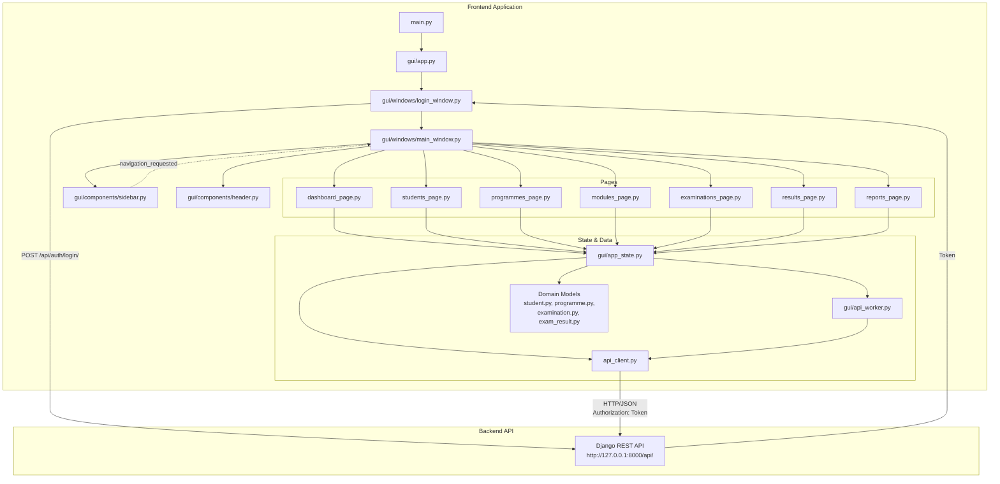

# Frontend — PyQt6 Desktop Application

This document provides comprehensive technical documentation for the frontend of the Digital Examination Results Management System. It is intended for developers who need to understand, configure, maintain, and extend the PyQt6 desktop application.

## A. Frontend Overview

**Purpose:** The frontend is a PyQt6 desktop application that provides a graphical user interface for managing academic programmes, students, modules, examinations, results, and reports. It communicates exclusively with the Django REST API backend via HTTP/JSON.

**Framework and libraries:**
- PyQt6 ≥ 6.6, < 7 — GUI framework
- requests ≥ 2.31, < 3 — HTTP client for API communication
- Python standard library (decimal, urllib, json, etc.)

**GUI Architecture:**
- Single-window application with sidebar navigation
- Pages loaded dynamically into central widget
- Background API worker threads for non-blocking network operations
- Centralized `AppState` service layer for data management and caching
- Token-based authentication persisted in memory

**Communication with Django backend:**
- All data operations via `ApiClient` (REST/JSON)
- Base URL configurable via `EXAM_API_URL` environment variable (default `http://127.0.0.1:8000`)
- Timeout configurable via `EXAM_API_TIMEOUT` (default 10 seconds)
- Authentication: DRF token sent as `Authorization: Token <token>` header
- Token obtained via `POST /api/auth/login/`, stored in `ApiClient`, cleared on logout

## B. Frontend Architecture

### Main Application Entry Point

- `frontend/main.py` — Root launcher. Parses `--console` flag for CLI mode; otherwise starts PyQt GUI via `gui.app.run()`.
- `gui/app.py` — Creates `QApplication`, applies theme stylesheet, shows `LoginWindow`.

### Main Window

- `gui/windows/main_window.py` — `MainWindow` with sidebar navigation, header, and stacked page widget.
- Sidebar buttons: Dashboard, Students, Programmes, Modules, Examinations, Results, Reports, Settings.
- Header shows institution name, user name, logout button.
- Pages instantiated on first access, cached in `MainWindow`.

### Navigation System

- `gui/components/sidebar.py` — `Sidebar` widget with navigation buttons. Emits `navigation_requested(page_name)` signal.
- `MainWindow` connects sidebar signal to `_show_page(page_name)` which manages the page stack.

### Pages

Each page in `gui/pages/` is a `QWidget` subclass receiving `AppState` instance:
- `dashboard_page.py` — Dashboard counts and recent results
- `students_page.py` — Student CRUD with search/filter
- `programmes_page.py` — Programme/module management
- `modules_page.py` — Module management (integrated with programmes)
- `examinations_page.py` — Examination and question management
- `results_page.py` — Result entry, edit, delete with grade preview
- `reports_page.py` — Student performance reports table

### Components

Reusable UI components in `gui/components/`:
- `data_table.py` — `DataTable` with sorting, selection, standard columns
- `header.py` — `HeaderBar` with institution name, user, logout
- `sidebar.py` — Navigation sidebar
- `stat_card.py` — Dashboard statistic cards

### Dialogs

Modal dialogs for create/edit operations:
- `StudentDialog` (in `students_page.py`) — Add/edit student
- `ResultDialog` (in `results_page.py`) — Record/edit result with live grade preview
- Programme/Module/Examination/Question dialogs in respective pages

### API Client

- `api_client.py` — `ApiClient` class handling all HTTP communication:
  - `request(method, path, payload)` — Core request method with error handling
  - Convenience methods: `get()`, `post()`, `put()`, `delete()`
  - Domain-specific methods: `list_students()`, `create_student()`, `create_result()`, etc.
  - Token management: `login()`, `logout()`, `token` property
  - Configurable timeout via `EXAM_API_TIMEOUT`

### API Worker

- `gui/api_worker.py` — `ApiWorker(QThread)` runs API operations in background:
  - Prevents UI freezing during network requests
  - Emits `succeeded(result)`, `failed(error)`, `finished` signals
  - Pages use `_run_api_task(operation, success_callback, error_callback)`

### Application State

- `gui/app_state.py` — `AppState` singleton-like service layer:
  - Holds `ApiClient`, user account info, institution name
  - Caches reference data: programmes, modules, examinations, academic years
  - Provides data loading methods: `load_students()`, `load_records()`, `load_results()`, `load_reports()`, `load_dashboard()`
  - Provides mutation methods: `save_record()`, `update_student()`, `delete_record()`, `save_programmes()`, `save_examinations()`, `create_result()`, `update_result()`, `delete_result()`
  - Maps API responses to frontend domain models (`Student`, `Programme`, `Module`, `Examination`, `Question`)

### Authentication Flow

1. `LoginWindow` (`gui/windows/login_window.py`) shows login form with "First-time institution setup" link.
2. On login: calls `ApiClient.login(username, password)` → `POST /api/auth/login/`
3. On success: token stored in `ApiClient`, `AppState` created with account info
4. `MainWindow` shown, `AppState.refresh_reference_data()` loads programmes, modules, examinations, academic years
5. On logout: `ApiClient.logout()` → `POST /api/auth/logout/`, token cleared, return to `LoginWindow`

### Data Presentation

- Tables use `DataTable` component with standardized columns
- Data formatted for display (dates, numbers, grades)
- Search/filter via debounced input (250ms timer)
- Pagination not implemented (all records loaded)

### Mermaid Frontend Architecture Diagram



## C. Frontend Directory Structure

```
frontend/
├── main.py                     # Root launcher (GUI or --console CLI)
├── requirements.txt            # PyQt6, requests
├── README.md                   # This file
├── student.py                  # Student domain model
├── programme.py                # Programme, Module domain models
├── examination.py              # Examination, Question domain models
├── exam_result.py              # ExamResult domain model (CLI grading)
├── storage.py                  # JSON record store (CLI only)
├── programmes.json             # Default programme catalogue (CLI)
├── api_client.py               # HTTP API client
├── instance/                   # Legacy SQLite (unused)
├── docs/                       # Documentation
│   ├── architecture.md
│   ├── developer_guide.md
│   └── user_guide.md
├── screenshots/                # Screenshot assets
├── tests/                      # Frontend tests
│   ├── __init__.py
│   ├── test_api_client.py
│   ├── test_login.py
│   ├── test_registration.py
│   ├── test_student_integration.py
│   ├── test_validation.py
│   └── test_live_student_workflow.py
└── gui/
    ├── __init__.py
    ├── app.py                  # QApplication setup, theme
    ├── app_state.py            # Central data/service layer
    ├── api_worker.py           # Background API thread
    ├── authentication.py       # Login helpers
    ├── styles/
    │   ├── __init__.py
    │   └── theme.py            # QSS stylesheet
    ├── components/
    │   ├── __init__.py
    │   ├── data_table.py       # Sortable table widget
    │   ├── header.py           # Header bar
    │   ├── sidebar.py          # Navigation sidebar
    │   └── stat_card.py        # Dashboard stat cards
    ├── windows/
    │   ├── __init__.py
    │   ├── login_window.py     # Login + first-time setup
    │   ├── main_window.py      # Main window with page stack
    │   └── registration_window.py # First-time institution setup
    └── pages/
        ├── __init__.py
        ├── dashboard_page.py
        ├── students_page.py
        ├── programmes_page.py
        ├── modules_page.py
        ├── examinations_page.py
        ├── results_page.py
        └── reports_page.py
```

### Important Files

| File | Responsibility |
|---|---|
| `main.py` | Entry point; CLI (`--console`) or GUI mode |
| `api_client.py` | All backend HTTP communication |
| `gui/app_state.py` | Central state, caching, data mapping, mutations |
| `gui/app.py` | Application bootstrap, theme |
| `gui/windows/main_window.py` | Main window, page stack, navigation |
| `gui/windows/login_window.py` | Login, registration link, token handling |
| `gui/api_worker.py` | Background thread for non-blocking API calls |
| `gui/pages/*.py` | Individual page implementations |

## D. Installation and Setup

### Prerequisites

- Python 3.10+
- Backend API running at configured URL (default `http://127.0.0.1:8000`)

### Virtual Environment and Dependencies

```powershell
cd frontend
py -m venv .venv
.\.venv\Scripts\Activate.ps1
python -m pip install --upgrade pip
python -m pip install -r requirements.txt
```

### Configure Backend API URL

Set environment variable (optional, defaults to `http://127.0.0.1:8000`):

```powershell
$env:EXAM_API_URL = "http://127.0.0.1:8000"
```

Configure timeout (optional, default 10 seconds):

```powershell
$env:EXAM_API_TIMEOUT = "15"
```

### Start the Frontend Application

From repository root (recommended):

```powershell
python main.py
```

Or from `frontend/`:

```powershell
cd frontend
python main.py
```

### Run Console Workflow (Legacy JSON Mode)

```powershell
cd frontend
python main.py --console
```

## E. Frontend Configuration

### Environment Variables

| Variable | Default | Description |
|---|---|---|
| `EXAM_API_URL` | `http://127.0.0.1:8000` | Backend API base URL |
| `EXAM_API_TIMEOUT` | `10` | Request timeout in seconds |

### Application Settings

- Theme: Defined in `gui/styles/theme.py` (QSS stylesheet)
- Institution name: Loaded from backend via `/api/auth/me/`, cached locally in `InstitutionNameStore` (`storage.py`)
- Window geometry/state: Not persisted (resets on restart)

### Backend Connectivity Requirements

- Backend must be running and accessible at `EXAM_API_URL`
- `/api/status/` must return `{"status": "ok"}` (database connected)
- Authentication endpoints must be functional
- CORS not required (same-origin not enforced for desktop app)

## F. User Interface Modules

### 1. Login

**File:** `gui/windows/login_window.py`

**Purpose:** Authenticate user, obtain token, handle first-time institution setup.

**Available Actions:**
- Enter username/password → `POST /api/auth/login/`
- Click "First-time institution setup" → opens `RegistrationWindow`
- On success: token stored, `MainWindow` shown

**API Endpoints Used:**
- `POST /api/auth/login/`
- `POST /api/auth/register/` (via registration window)
- `GET /api/auth/registration-status/`

**Validation:**
- Username and password required
- Backend validates credentials, returns 401 on failure
- Token stored in `ApiClient`, cleared on logout

**User Permissions:** Public access

---

### 2. Dashboard

**File:** `gui/pages/dashboard_page.py`

**Purpose:** Overview of system statistics and recent student performance.

**Data Displayed:**
- Stat cards: Total Students, Programmes, Modules, Examinations, Results
- Recent results table: Student name, programme, average score, overall grade (top 10 by latest result)

**API Endpoints Used:**
- `GET /api/dashboard/`

**User Permissions:** Institution user (admin or staff)

---

### 3. Students

**File:** `gui/pages/students_page.py`

**Purpose:** Full CRUD for student records.

**Available Actions:**
- Search by name or admission number (debounced)
- Filter by programme
- Add student (opens `StudentDialog`)
- Edit student (opens `StudentDialog` with current data)
- Delete student (admin only; blocked if results exist)
- Refresh

**Data Displayed:** Table with Student ID, Name, Age, Gender, Programme

**API Endpoints Used:**
- `GET /api/students/?search=&programme=`
- `POST /api/students/`
- `GET /api/students/<student_id>/`
- `PUT /api/students/<student_id>/`
- `DELETE /api/students/<student_id>/`

**Validation Rules:**
- Student ID (admission number) required, unique
- First/last name: letters and spaces only
- Age: 0–120
- Gender: required (Male/Female/Other)
- Programme: required, must be active

**User Permissions:**
- View, create, update: Staff or Admin
- Delete: Admin only

---

### 4. Programmes

**File:** `gui/pages/programmes_page.py`

**Purpose:** Manage academic programmes and their modules.

**Available Actions:**
- Add programme (code, name, description, active)
- Edit programme
- Delete programme (admin only; blocked if referenced)
- Add/edit modules within programme
- Module fields: code, name, level, semester, description, active

**Data Displayed:** Programme list with modules nested or separate tab

**API Endpoints Used:**
- `GET /api/programmes/`
- `POST /api/programmes/`
- `GET /api/programmes/<id>/`
- `PUT /api/programmes/<id>/`
- `DELETE /api/programmes/<id>/`
- `GET /api/modules/`
- `POST /api/modules/`
- `PUT /api/modules/<id>/`
- `DELETE /api/modules/<id>/`

**Validation Rules:**
- Programme code and name required, unique
- Module code and name required
- Level/semester: strings (default "1")

**User Permissions:**
- View: Institution users
- Create/update/delete: Admin only

---

### 5. Modules

**File:** `gui/pages/modules_page.py`

**Purpose:** Module management (integrated with programmes page).

**Available Actions:** Same as programmes page — modules managed within programme context.

**API Endpoints Used:** Same as programmes.

---

### 6. Examinations

**File:** `gui/pages/examinations_page.py`

**Purpose:** Create and manage examinations and their questions.

**Available Actions:**
- Add examination (code, title, module, academic year, type, date, max score, duration, status)
- Edit examination
- Delete examination (admin only; blocked if referenced)
- Add/edit/delete questions for examination
- Question types: MCQ, True/False, Short Answer
- MCQ/True-False: options (JSON array), correct answer
- Short Answer: no options, manual marking

**Data Displayed:** Examination list with questions expandable

**API Endpoints Used:**
- `GET /api/examinations/`
- `POST /api/examinations/`
- `GET /api/examinations/<id>/`
- `PUT /api/examinations/<id>/`
- `DELETE /api/examinations/<id>/`
- `GET /api/examinations/<id>/questions/`
- `POST /api/examinations/<id>/questions/`
- `GET /api/questions/<id>/`
- `PUT /api/questions/<id>/`
- `DELETE /api/questions/<id>/`

**Validation Rules:**
- Examination code, title, module, academic year, type required
- Maximum score > 0
- Question text, type, marks, order required
- Marks > 0
- Question order: positive integer

**User Permissions:**
- View: Institution users
- Create/update/delete: Admin only
- Correct answers visible only to admin

---

### 7. Results

**File:** `gui/pages/results_page.py`

**Purpose:** Record, edit, and delete examination results with live grade preview.

**Available Actions:**
- Record new result:
  1. Search/select student
  2. Select examination (filtered by student's programme modules)
  3. Enter score (validated against exam max score)
  4. Live grade preview updates as score changes
  5. Optional remarks
  6. Save → `POST /api/results/`
- Edit existing result (score, remarks)
- Delete result (admin only)
- Search results

**Data Displayed:** Table with Student ID, Student Name, Programme, Subject, Score, Grade

**API Endpoints Used:**
- `GET /api/results/?student=&examination=`
- `POST /api/results/`
- `PUT /api/results/<id>/`
- `DELETE /api/results/<id>/`
- `GET /api/students/` (for student selection)
- `GET /api/examinations/` (for exam selection)

**Validation Rules:**
- Student and examination required
- Score: finite number, 0 ≤ score ≤ examination.maximum_score
- Duplicate (student, examination) rejected by backend
- Grade calculated server-side, preview matches backend logic

**Grade Calculation (Preview):**
```python
# Frontend mirrors backend calculate_grade
percentage = score * 100 / maximum_score
≥70 = A, ≥60 = B, ≥50 = C, ≥40 = D, else F
```

**User Permissions:**
- View, create, update: Staff or Admin
- Delete: Admin only

---

### 8. Reports

**File:** `gui/pages/reports_page.py`

**Purpose:** Display student performance reports with aggregate statistics.

**Data Displayed:**
- Aggregate stats: Total students, programmes, modules, examinations, results, passed, failed, grade distribution
- Student performance table: Admission number, Name, Programme, Total Score, Average Score, Overall Grade

**API Endpoints Used:**
- `GET /api/reports/`

**User Permissions:** Institution users

---

### 9. Settings / Administration

**File:** `gui/windows/registration_window.py` (first-time setup), integrated in main window header/logout

**Purpose:** Institution name update, logout.

**Available Actions:**
- Update institution name (admin only) → `PATCH /api/auth/institution/`
- Logout → `POST /api/auth/logout/`, clear token, return to login

**API Endpoints Used:**
- `GET /api/auth/me/` (loads institution name on startup)
- `PATCH /api/auth/institution/`
- `POST /api/auth/logout/`

---

## G. API Integration

### API Client Implementation

**File:** `api_client.py`

**Class:** `ApiClient`

**Key Methods:**
```python
# Core
request(method, path, payload=None) -> dict|None
get(path) -> dict|list
post(path, payload) -> dict
put(path, payload) -> dict
delete(path) -> None

# Authentication
login(username, password) -> dict  # Sets self.token
logout() -> None  # Clears self.token
registration_status() -> dict
register_institution_administrator(...) -> dict

# Domain-specific
list_students(search="", programme=None) -> list
get_student(student_id) -> dict
create_student(payload) -> dict
update_student(student_id, payload) -> dict
delete_student(student_id) -> None

# Generic query builder
@staticmethod
query_path(path, **params) -> str  # Builds URL with query string
```

**Request Flow:**
1. Build URL: `f"{self.base_url}{path}"`
2. Headers: `Accept: application/json`, `Authorization: Token <token>` (if set)
3. `requests.Session.request()` with timeout
4. Handle response:
   - 401: Clear token, raise `ApiError`
   - ≥400: Parse error detail, raise `ApiError`
   - 204/empty: Return `None`
   - Success: Return `response.json()`

**Error Handling:**
- `ApiError` exception with message and optional `status_code`
- Network errors wrapped with user-friendly message
- JSON decode errors wrapped

### Authentication Headers

All authenticated requests include:
```
Authorization: Token <drf_token>
Accept: application/json
Content-Type: application/json (for POST/PUT)
```

### Response Handling

- Successful responses parsed as JSON
- Error responses: `{"error": "message"}` or DRF-style `{"field": ["error"]}`
- `ApiError` raised for non-2xx status codes

### Data Loading

- `AppState.refresh_reference_data()` loads programmes, modules, examinations, academic years on startup and after mutations
- `AppState.load_students()` fetches student list with optional search/programme filter
- `AppState.load_records()` loads students + their results, computes totals/averages
- `AppState.load_results()` loads results with student/examination details
- `AppState.load_reports()` fetches aggregated report data
- `AppState.load_dashboard()` fetches dashboard counts + recent results

### Data Refreshing

- Manual refresh buttons on each page
- Automatic refresh after successful create/update/delete
- `refresh_reference_data()` called after programme/module/examination mutations

### Create, Read, Update, Delete Operations

| Operation | Frontend Method | API Endpoint |
|---|---|---|
| Create Student | `AppState.save_record()` | `POST /api/students/` |
| Read Student | `AppState.load_student()` | `GET /api/students/<id>/` |
| Update Student | `AppState.update_student()` | `PUT /api/students/<id>/` |
| Delete Student | `AppState.delete_record()` | `DELETE /api/students/<id>/` |
| Create Result | `AppState.create_result()` | `POST /api/results/` |
| Update Result | `AppState.update_result()` | `PUT /api/results/<id>/` |
| Delete Result | `AppState.delete_result()` | `DELETE /api/results/<id>/` |
| Create Programme | `AppState.save_programmes()` | `POST /api/programmes/` |
| Update Programme | `AppState.save_programmes()` | `PUT /api/programmes/<id>/` |
| Delete Programme | `AppState.delete_programme()` | `DELETE /api/programmes/<id>/` |
| Create Examination | `AppState.save_examinations()` | `POST /api/examinations/` |
| Update Examination | `AppState.save_examinations()` | `PUT /api/examinations/<id>/` |
| Delete Examination | `AppState.delete_examination()` | `DELETE /api/examinations/<id>/` |

### Data Flow: GUI → Backend → PostgreSQL

```
User Action (GUI)
    ↓
Page Method (e.g., StudentsPage.add_student)
    ↓
Validation (local + Student model)
    ↓
ApiWorker thread → ApiClient.request()
    ↓
HTTP POST /api/students/ with JSON payload
    ↓
Django View (config.views.students)
    ↓
StudentSerializer validation
    ↓
Student.objects.create() → PostgreSQL INSERT
    ↓
Response JSON → ApiClient → ApiWorker.succeeded
    ↓
Page callback → Refresh table
```

## H. Results Entry Workflow

Detailed step-by-step workflow for recording an examination result:

### 1. Retrieve Students
- User opens Results page
- `ResultsPage.refresh()` calls `AppState.load_results()`
- `AppState.load_results()` → `GET /api/results/` (or filtered)
- Students loaded via `AppState.load_students()` for selection dialog

### 2. Retrieve Examinations
- `AppState.refresh_reference_data()` loads examinations on startup
- `AppState.examinations` cached with module, academic year, questions

### 3. Select a Student
- User clicks "Record Result" → `ResultDialog` opens
- Student combo populated from `AppState.load_records()` (students with admission number, name, programme)
- Search filter narrows list by name or admission number

### 4. Select an Examination
- On student selection, examinations filtered to match student's programme modules
- `ResultDialog._get_student_programme_modules()` gets module IDs for student's programme
- Examination combo shows only exams for those modules

### 5. Enter the Examination Score
- User enters score in `QDoubleSpinBox` (2 decimals, step 0.5)
- Maximum limited to examination's `total_marks` (from `maximum_score`)

### 6. Validate the Score
- Frontend validation in `ResultDialog._validate_and_accept()`:
  - Student selected
  - Examination selected
  - Score ≥ 0
  - Score ≤ examination's maximum score
- Backend validation in `config.views.results()`:
  - Score finite, 0 ≤ score ≤ examination.maximum_score
  - No existing result for student+examination

### 7. Submit the Result
- `ResultDialog.accept()` returns values
- `ResultsPage.record_result()` calls `AppState.create_result()`:
  ```python
  {
      "student_id": student_record_id,      # Integer PK from students table
      "examination_id": examination_record_id,  # Integer PK from examinations table
      "score": float_value,
      "remarks": "optional text"
  }
  ```
- `ApiClient.post("/api/results/", payload)` → `POST /api/results/`

### 8. Receive Backend Confirmation
- Backend creates `ExamResult`, calculates grade, returns serialized result:
  ```json
  {
    "result_id": 123,
    "student_id": 1,
    "examination_id": 5,
    "score": "85.50",
    "grade": "A",
    "remarks": "Good performance",
    "date_recorded": "2024-06-15T10:30:00",
    "last_updated": "2024-06-15T10:30:00"
  }
  ```
- `ApiClient` returns dict, `ApiWorker` emits `succeeded`
- Page shows success message, refreshes table

### 9. Display the Saved Result
- `ResultsPage.refresh()` reloads results via `AppState.load_results()`
- Table shows: Student ID, Student Name, Programme, Subject, Score, Grade

### 10. Edit or Delete Results According to Permissions
- **Edit:** Select row → "Edit" → `ResultDialog` pre-filled with current data
  - Student/examination locked (read-only)
  - Score and remarks editable
  - `AppState.update_result(result_id, {"score": new_score, "remarks": new_remarks})`
  - `PUT /api/results/<result_id>/`
- **Delete:** Select row → "Delete" (admin only) → confirmation → `AppState.delete_result(result_id)`
  - `DELETE /api/results/<result_id>/`

## I. Frontend Testing

### Run All Frontend Tests

```powershell
cd frontend
python -m unittest discover -s tests -v
```

### Test Modules

| Test File | Purpose |
|---|---|
| `tests/test_api_client.py` | `ApiClient` request/response handling, error cases |
| `tests/test_login.py` | Login window, authentication flow |
| `tests/test_registration.py` | First-time institution registration |
| `tests/test_student_integration.py` | Student CRUD via API |
| `tests/test_validation.py` | Input validation (Student, ExamResult models) |
| `tests/test_live_student_workflow.py` | **Opt-in** live PyQt-to-API test (requires PostgreSQL, authorized account) |

### Live Student Workflow Test (Opt-in)

Requires:
- Running backend with PostgreSQL
- Existing authorized institution administrator account
- Permission to create/delete temporary student record

```powershell
cd frontend
$env:EXAM_RUN_LIVE_STUDENT_TESTS = "YES"
$env:EXAM_LIVE_TEST_USERNAME = "your-admin-username"
python -m unittest tests.test_live_student_workflow -v
# Prompts for password without echo
# Creates uniquely named temporary student
# Exercises create/search/edit/reload/delete flow
# Cleans up only that generated student
Remove-Item Env:EXAM_RUN_LIVE_STUDENT_TESTS
Remove-Item Env:EXAM_LIVE_TEST_USERNAME
```

### GUI Test Notes

- Tests use PyQt6 with `QT_QPA_PLATFORM=offscreen` when needed
- No display required for headless CI
- API tests mock `requests.Session` for isolation

## J. Troubleshooting

### GUI Startup Issues

| Problem | Cause | Solution |
|---|---|---|
| `ModuleNotFoundError: PyQt6` | Dependencies not installed | Run `pip install -r requirements.txt` in activated venv |
| `ModuleNotFoundError: requests` | Dependencies not installed | Same as above |
| Application closes immediately | Backend not running, login fails | Start backend first: `cd backend && python manage.py runserver` |
| "Could not connect to backend" | Wrong `EXAM_API_URL` | Set correct URL: `$env:EXAM_API_URL="http://host:port"` |
| Theme not applied | `gui/styles/theme.py` import issue | Check import path, ensure `THEME_QSS` is defined |

### Backend Connection Errors

| Problem | Cause | Solution |
|---|---|---|
| `ApiError: Could not connect to the backend` | Backend not running | Start backend on `127.0.0.1:8000` |
| `ApiError: Backend returned HTTP 503` | PostgreSQL unavailable | Check PostgreSQL service, `PGHOST`/`PGPORT` in backend `.env` |
| `ApiError: Backend returned HTTP 401` | Token expired/invalid | Log out and log in again (tokens expire in 12 hours) |
| `ApiError: Backend returned HTTP 403` | Insufficient permissions | Ensure account has `institution_admin` or `staff` role |

### Authentication Failures

| Problem | Cause | Solution |
|---|---|---|
| "Invalid credentials" | Wrong username/password | Verify credentials; use "First-time institution setup" if no admin exists |
| Registration fails | Admin already exists | Registration only works once; use admin provisioning instead |
| Token not saved | Network error during login | Check backend logs, ensure `/api/auth/login/` returns token |

### Data Loading Problems

| Problem | Cause | Solution |
|---|---|---|
| Empty tables | No data in PostgreSQL | Verify academic tables populated; check `AppState.refresh_reference_data()` |
| "Select a programme" warning | No active programmes | Create programmes via Programmes page (admin) |
| "Create an examination first" | No examinations | Create examinations via Examinations page (admin) |
| Grade preview shows "-" | No examination selected | Select examination in ResultDialog |
| Student search returns no results | Search term mismatch | Clear search, check programme filter |

### Common Error Messages

| Message | Location | Resolution |
|---|---|---|
| "A result already exists for this student and examination" | Results page | Edit existing result instead of creating new |
| "This student has examination results and cannot be deleted" | Students page | Delete results first (admin), then student |
| "This programme is referenced by other records" | Programmes page | Remove dependent modules/students first |
| "Score cannot exceed the examination's maximum score" | ResultDialog | Check examination's `maximum_score`, adjust score |

### Debugging Tips

1. **Enable backend debug logging:** Set `DJANGO_DEBUG=True` in backend `.env`
2. **Check network requests:** Use browser devtools on `http://127.0.0.1:8000/api/` or proxy tool
3. **Inspect `AppState`:** Add debug prints in `gui/app_state.py` methods
4. **Verify token:** Print `ApiClient.token` after login
5. **Check PostgreSQL:** Run `python manage.py dbshell` in backend to query tables directly

---

*See also: [Root README](../README.md) • [Backend README](../backend/README.md) • [Architecture](docs/architecture.md) • [User Guide](docs/user_guide.md) • [Developer Guide](docs/developer_guide.md)*